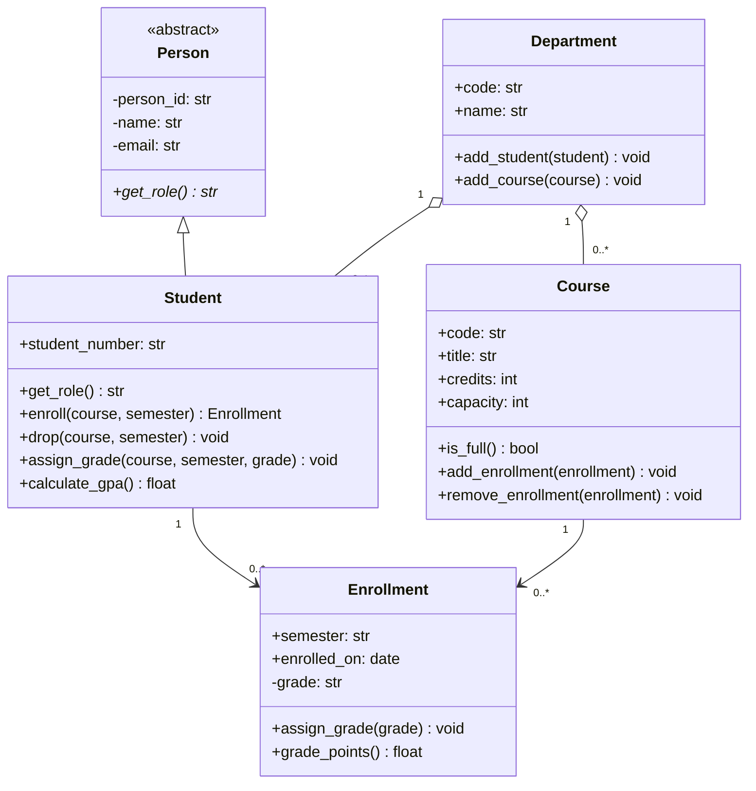

# Mapping Design to Code: Student Class Diagram

This project maps a UML class diagram of a student system to Python code.

## Class Diagram



## Design-to-Code Mapping

| UML element | Code |
| --- | --- |
| Class | Python `class`, one module per class |
| Abstract class `Person` | `ABC` with an `@abstractmethod` |
| Private attribute (`-`) | `_attribute` with a read-only `@property` |
| Public attribute (`+`) | Instance attribute |
| Operation | Method |
| Inheritance `Student` to `Person` | `class Student(Person)` and `super().__init__()` |
| Aggregation with `Department` | `Department` keeps lists of existing objects |
| Association class `Enrollment` | Holds `student`, `course`, semester, and grade |
| Multiplicity `0..*` | `list` |
| Multiplicity `1` | Required constructor argument |

## Run

Requires Python 3.9 or newer. No external packages are needed.

```bash
python main.py
python -m unittest discover tests
```
