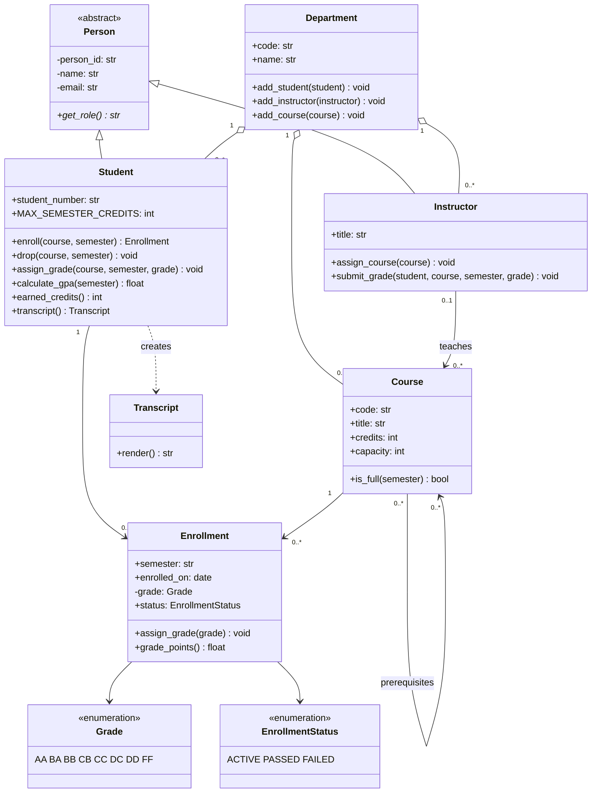

# Mapping Design to Code: Student Class Diagram

**Course:** AII003 | Software Engineering | Priscilla Olawale

**Student:** Gülşah Gümüş | 20221903

This project maps a UML class diagram of a student system to Python code.

## Class Diagram



## Design-to-Code Mapping

| UML element | Code |
| --- | --- |
| Class | Python `class`, one module per main class |
| Abstract class `Person` | `ABC` with an `@abstractmethod` |
| Private attribute (`-`) | `_attribute` with a read-only `@property` |
| Public attribute (`+`) | Instance attribute |
| Operation | Method |
| Inheritance | `class Student(Person)`, `class Instructor(Person)` |
| Polymorphism | Each subclass implements `get_role()` |
| Aggregation with `Department` | `Department` keeps lists of existing objects |
| Association class `Enrollment` | Holds student, course, semester, and grade |
| Self-association | `Course.prerequisites` |
| Enumeration | `Grade` and `EnrollmentStatus` use `Enum` |
| Dependency | `Student.transcript()` creates a `Transcript` |
| Multiplicity `0..*` | `list` or `tuple` |
| Multiplicity `1` | Required constructor argument |

## Business Rules

- A student cannot enroll twice in the same course in one semester.
- Course capacity is checked per semester.
- Prerequisites must be passed before enrollment.
- A student can take at most 30 credits per semester.
- A failed course can be retaken, and only the latest grade counts in the GPA.
- A passed course cannot be retaken, and a graded course cannot be dropped.
- Only the course instructor can submit a grade.

## Run

Requires Python 3.9 or newer. No external packages are needed.

The program lists the 2026-2027 Fall courses without grades. Grades and rules are
demonstrated in a separate scenario with fictional data. Credits and capacities are
model values, not official course data.

```bash
python main.py
python -m unittest discover tests
```
